# Reporte de práctica: Servidor de juego Erlang/OTP

## Datos de identificación

| Dato | Información |
|---|---|
| Estudiante | Gael Nolasco Ayala |
| Profesor | Rene Solis Reyes |
| Grupo | SC7C |
| Horario | 4:00 p. m. a 5:00 p. m. |
| Materia | Programación lógica y funcional |
| Proyecto | #17 — Servidor de juego |
| Aplicación | Tres en Raya con administración Erlang/OTP |

## 1. Resumen

Se implementó un servidor de Tres en Raya en Erlang/OTP. Cada partida vive en
un proceso independiente; el servidor valida turnos y movimientos, y el
cliente web permite jugar desde el navegador. Se conserva la pantalla del juego
original y se integran tres vistas administrativas diseñadas en Google Stitch.

El panel consume el backend real para mostrar partidas, eventos y métricas.
También se agregaron diagnóstico con Recon, avisos por WebSocket, pruebas de
supervisión y artefactos para release y systemd.

## 2. Objetivos de la práctica

- Aplicar procesos, concurrencia y supervisión de Erlang/OTP a partidas
  independientes.
- Integrar el backend con un cliente web y con pantallas administrativas de
  Google Stitch.
- Exponer endpoints HTTP de juego, salud y métricas.
- Verificar comportamiento normal y recuperación ante la caída de una
  partida.

## 3. Entorno y ejecución

Entorno de validación: Ubuntu 26.04.1 LTS sobre WSL 2, Erlang/OTP 27 y rebar3
3.26.0.

Desde Ubuntu/WSL, entrar a la raíz del proyecto y ejecutar:

```bash
cd /mnt/c/Users/USUARIO/Downloads/17-servidor-de-juego
rebar3 compile
rebar3 eunit
rebar3 shell
```

Reemplazar `USUARIO` por el usuario de Windows que contiene el proyecto. El
servidor escucha por defecto en el puerto `8080`, configurado mediante
`http_port` en `config/sys.config`.

## 4. Funcionalidad

### Juego web

1. Abrir `http://localhost:8080/`.
2. Escribir nombres distintos para los dos jugadores y crear una partida.
3. Alternar los turnos seleccionando casillas libres.
4. El backend rechaza movimientos fuera de turno, posiciones inválidas y
   casillas ocupadas; finaliza la partida con ganador o empate.

### Panel administrativo Stitch

- `/admin`: dashboard con partidas activas, jugadores en espera, promedio de
  duración, salud del servidor y eventos recientes.
- `/admin?vista=detalle&id=ID`: detalle de una partida activa.
- `/admin?vista=eventos`: bitácora, filtros y exportación de eventos.
- Las vistas se conectan a los endpoints reales y se actualizan por WebSocket
  con polling de respaldo.
- Las acciones sin endpoint real están deshabilitadas; los movimientos se
  hacen desde la pantalla del juego.

Proyecto original en Google Stitch:
[Tres en Raya P17](https://stitch.withgoogle.com/projects/5621764506680375490?pli=1)

### API y diagnóstico

| Método y ruta | Propósito |
|---|---|
| `GET /health` | Comprueba disponibilidad del servicio. |
| `GET /metrics` | Métricas del juego y diagnóstico del nodo con Recon. |
| `GET /api/admin` | Partidas activas, espera y duración promedio. |
| `GET /api/admin/eventos` | Eventos recientes del nodo. |
| `GET /api/partidas` | Lista partidas activas. |
| `POST /api/partidas?jugador1=Ana&jugador2=Luis` | Crea una partida. |
| `GET /api/partidas/ID` | Consulta el estado de una partida. |
| `POST /api/partidas/ID/movimientos?jugador=Ana&posicion=1` | Envía un movimiento validado. |
| `GET /ws/juego` | Publica avisos de actualización, finalización o caída. |

Las métricas e historial de eventos son volátiles y se reinician al reiniciar
el nodo. El promedio solo considera partidas terminadas con ganador o empate;
las caídas no cuentan como partidas completadas.

## 5. Diseño OTP y decisiones técnicas

- El supervisor raíz usa `one_for_one`: una falla de un servicio no reinicia
  los demás hijos.
- `p17_partidas_sup` administra hijos dinámicos; cada partida es un
  `gen_statem` con reinicio `temporary`.
- Una partida caída no se reinicia como si conservara su tablero: ese estado
  estaba en memoria y se perdió. La caída se registra y las demás partidas
  quedan aisladas.
- No se agregó un proceso de dominio por jugador. El estado por jugador es
  mínimo y el proceso de partida ya valida identidad y turno. Cada conexión
  WebSocket sí tiene su proceso Cowboy.
- Las pantallas Stitch de administración son de solo lectura cuando no existe
  una operación equivalente en el backend.

## 6. Fragmentos de código

### Estrategia del supervisor raíz

`src/p17_servidor_de_juego_sup.erl`:

```erlang
{ok, {#{strategy => one_for_one, intensity => 10, period => 60}, Hijos}}.
```

### Política de reinicio por partida

`src/p17_partidas_sup.erl` crea un hijo dinámico con reinicio temporal:

```erlang
Especificacion = #{
    id => Id,
    start => {p17_partida, start_link, [Jugador1, Jugador2]},
    restart => temporary,
    shutdown => 5000,
    type => worker,
    modules => [p17_partida]
}.
```

### Validación del turno

`src/p17_partida.erl` delega cada movimiento al estado `jugando`:

```erlang
handle_event({call, From}, {mover, Jugador, Posicion}, jugando, Datos) ->
    procesar_movimiento(From, Jugador, Posicion, Datos);
```

El código fuente completo debe entregarse como carpeta o ZIP del proyecto en
Idoceo, o mediante un enlace al repositorio actualizado. El repositorio base
asignado no contiene los cambios locales si estos no se han subido. Archivos
centrales:

- `src/p17_partida.erl`
- `src/p17_partidas_sup.erl`
- `src/p17_servidor_de_juego_sup.erl`
- `src/p17_http_server.erl` y `src/p17_http_handler.erl`
- `src/p17_eventos.erl` y `src/p17_ws_handler.erl`
- `priv/admin.html`, `priv/admin-detail.html`, `priv/admin-events.html` y
  `priv/admin-stitch.js`
- `test/p17_partida_tests.erl`, `test/p17_eventos_tests.erl` y
  `test/p17_servidor_de_juego_tests.erl`

## 7. Pruebas y resultados

| Comprobación | Resultado |
|---|---|
| `rebar3 clean` | Ejecutado durante la validación del proyecto. |
| `rebar3 compile` | Compilación correcta. |
| `rebar3 eunit` | **9 pruebas, 0 fallos.** |
| Recuperación de partida | La prueba detiene deliberadamente una partida y comprueba el comportamiento de supervisión y aislamiento. |
| `GET /health` | HTTP 200; `status: ok`. |
| `GET /metrics` | HTTP 200; respuesta con métricas de juego y diagnóstico Recon. |
| Guion Asciinema | Sintaxis Bash válida; incluye entorno WSL, OTP/rebar3, EUnit, health y metrics. |

El reporte de terminación `killed` que puede aparecer durante EUnit corresponde
a la prueba que detiene una partida intencionalmente; no es un fallo de la
suite.

## 8. Evidencias

### Diseños originales de Google Stitch

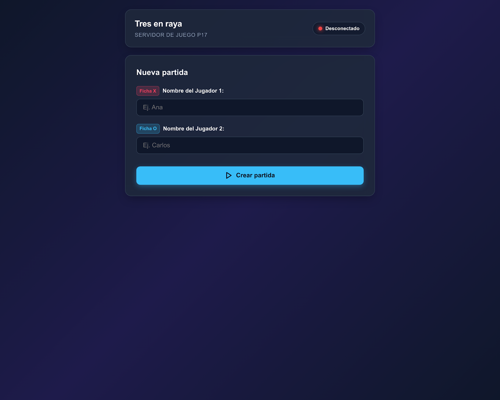

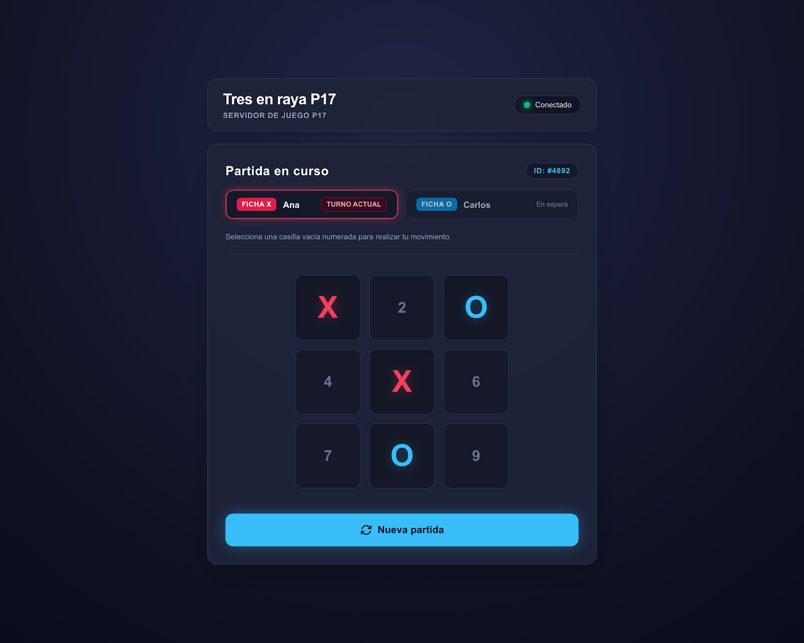

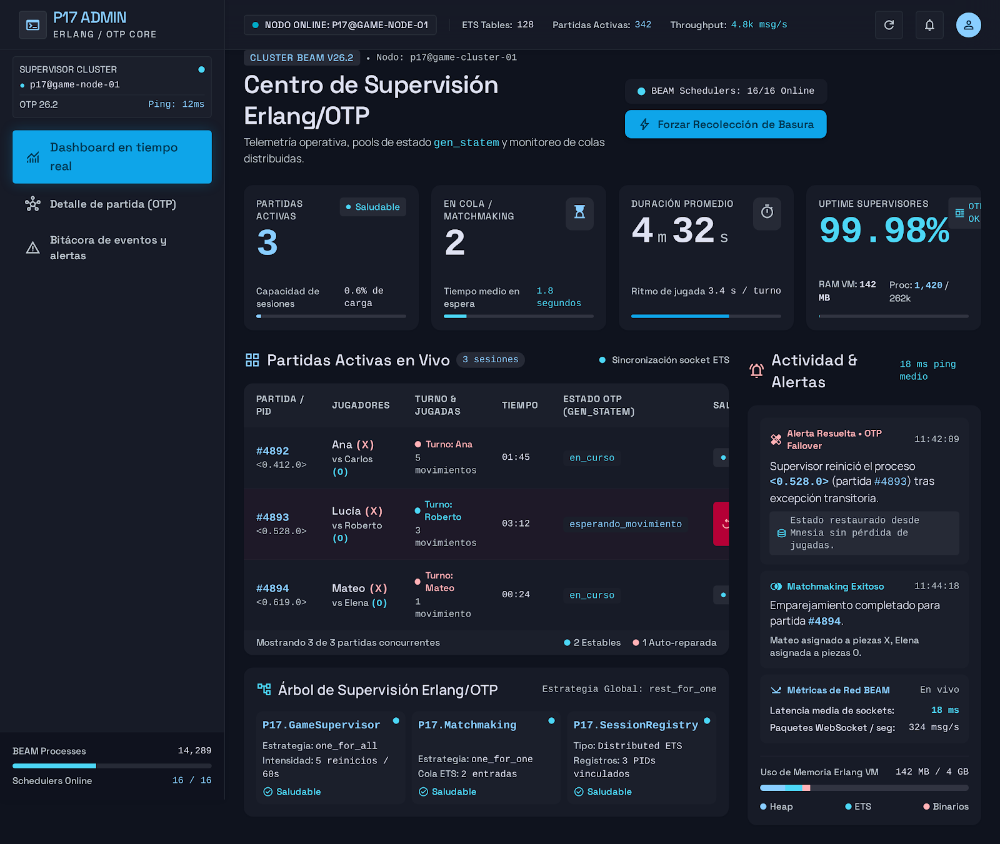

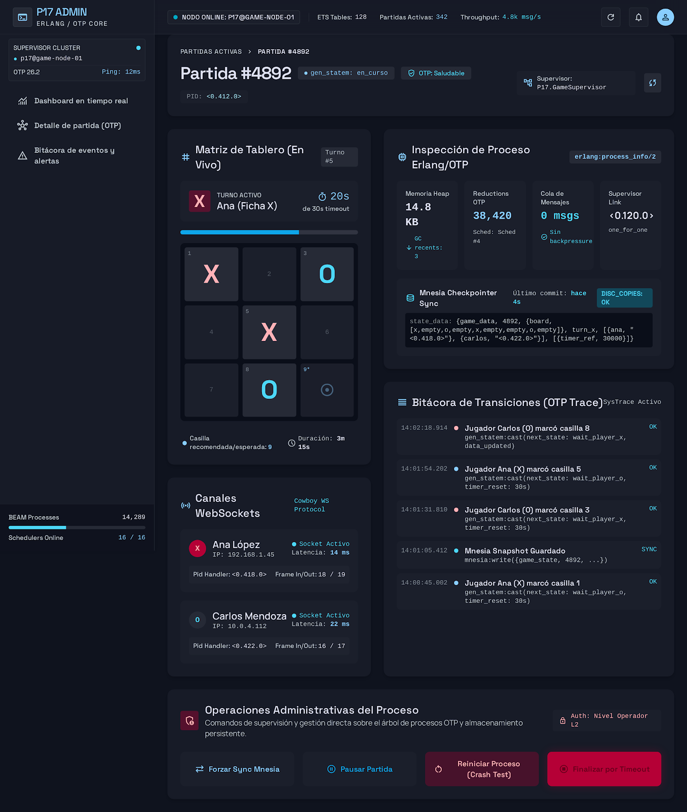

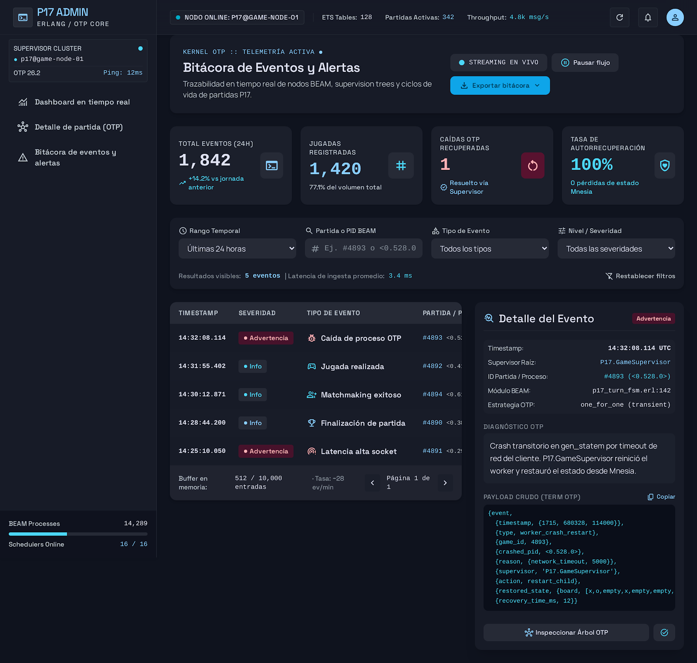

### Aplicación integrada con el backend

Las capturas se tomaron durante una partida de demostración con nombres
ficticios.

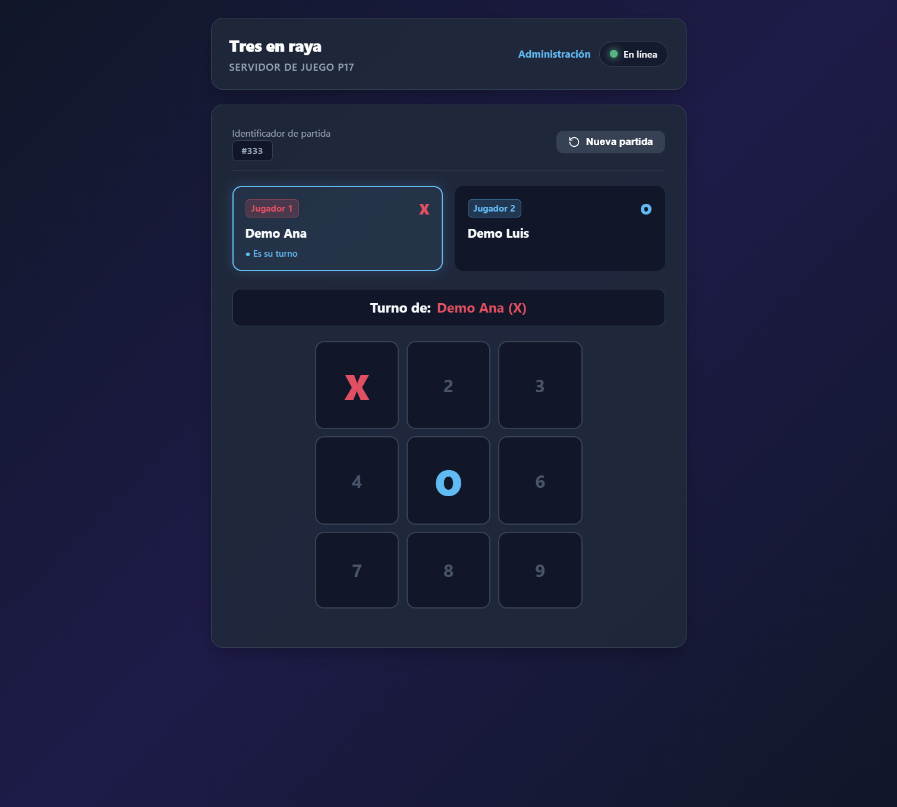

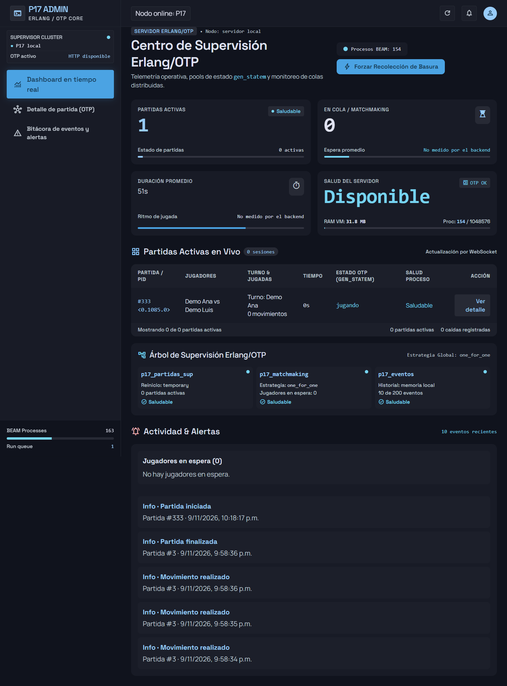

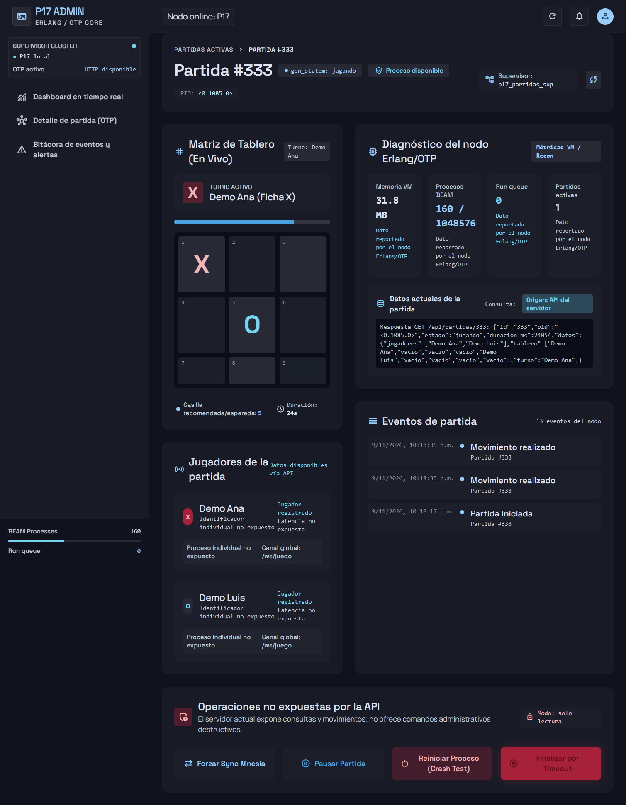

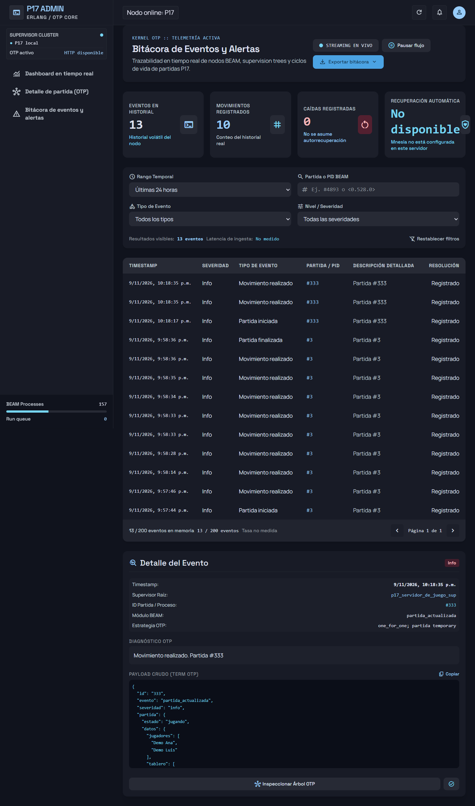

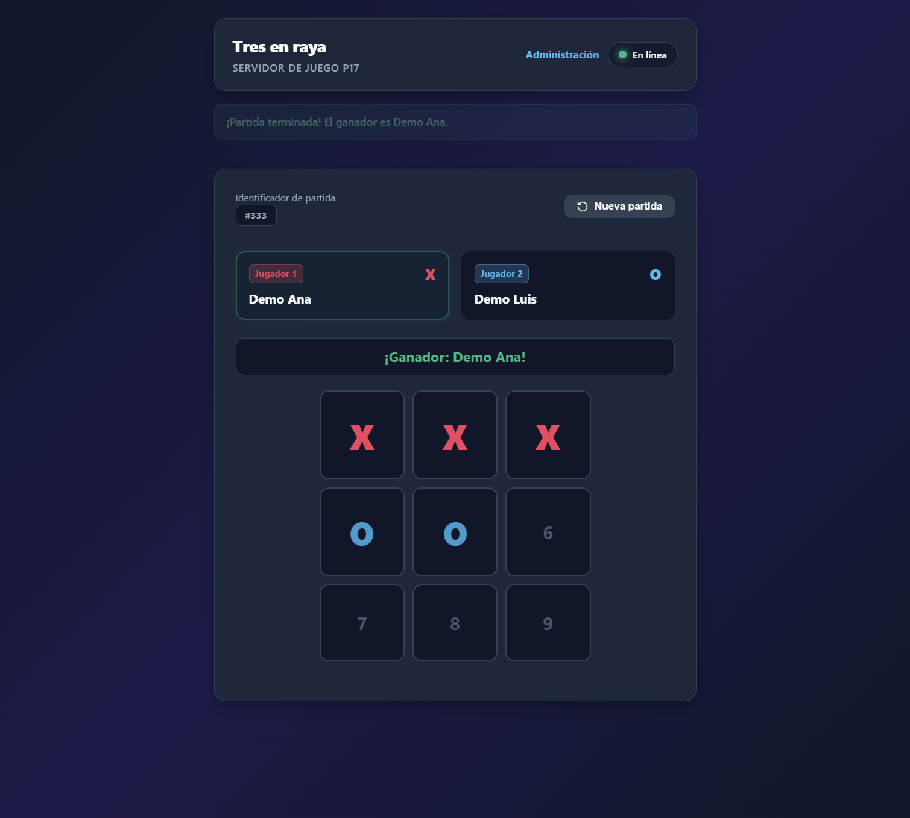

### Diagnóstico HTTP

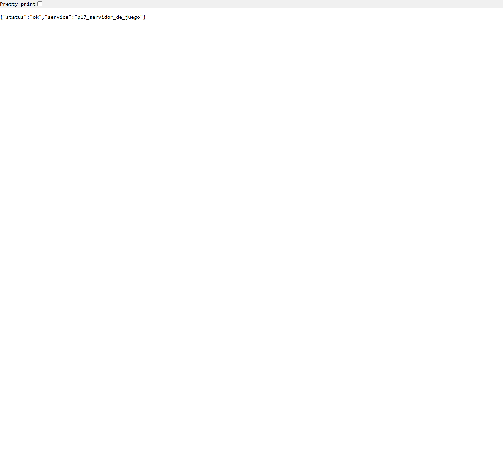

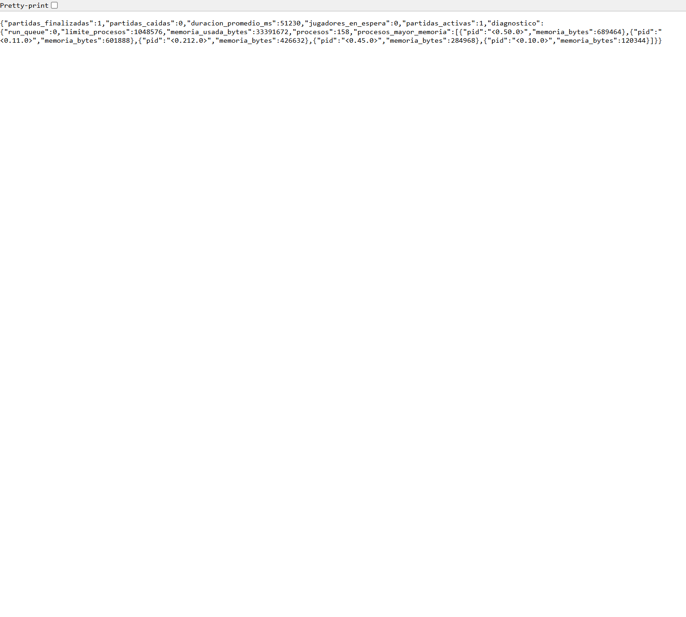

Las imágenes se sirven desde la rama `entrega-p17` del fork para que también
se visualicen al copiar este README a un Gist. Los diseños de Stitch originales
también están en `design/stitch_tres_en_raya_p17/`.

### Grabación Asciinema

La grabación real incluye fragmentos de `p17_partida.erl`, los supervisores y
las rutas HTTP, además de EUnit, `/health` y `/metrics`.

**Grabación:** [Abrir Asciinema](https://asciinema.org/a/X3JID0BLRKg7XCCo)

### Demostración Loom

[Ver demo del proyecto en Loom](https://www.loom.com/share/e04a9b309dcb4c2fa35a5b2c9c3696a2)

### Código fuente completo

**Código fuente completo:** [proyecto 17 en la rama de entrega](https://github.com/NolascoAyalaGael-07/erlang-proyectos/tree/entrega-p17/proyectos/17-servidor-de-juego)

## 9. Seguridad y alcance

El panel y las API administrativas no tienen autenticación; deben usarse solo
en una red de confianza. Las pantallas cargan estilos e iconos desde CDN, por
lo que requieren Internet para conservar su apariencia completa. El ejemplo
systemd es una plantilla: no se instaló ni habilitó ningún servicio del
sistema.

## 10. Conclusión

La práctica integra el juego web con procesos OTP por partida, supervisión,
diagnóstico HTTP y vistas administrativas diseñadas en Google Stitch. Las
pruebas automatizadas validan las reglas principales y el comportamiento ante
la caída de una partida. Las demostraciones en Loom y Asciinema complementan
el código, las pruebas y las capturas incluidas en la entrega.
